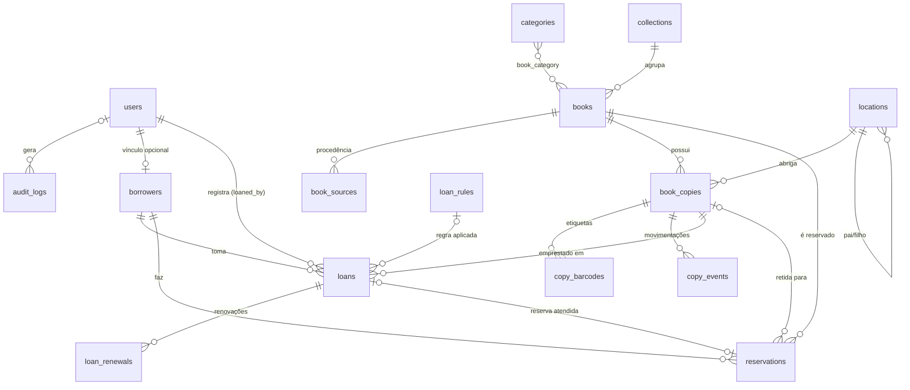

# 03 — Modelagem de domínio e banco de dados

Legenda de situação: ✅ existe · ✏️ existe, precisa de ajuste · 🆕 nova · ⏸️ avaliada e **não** criada agora.

## 1. Decisões de modelagem

| Pergunta | Decisão | Justificativa |
|---|---|---|
| **Autor** como tabela? | ⏸️ **Não agora.** Mantém `books.authors` (texto, "A; B") | A necessidade real é buscar por nome. Uma tabela exige resolver homônimos e variações ("Chaui, M." × "Marilena Chauí") sem fonte confiável; os metadados externos chegam como texto. Reavaliar se surgir "livros por autor", fichas de autor ou relatórios por autor |
| **Editora** como tabela? | ⏸️ **Não agora.** Mantém `books.publisher` | Hoje só filtra/exibe. Normalizar traria o problema de unificar "Moderna" × "Editora Moderna" sem benefício imediato |
| **Disciplina** × **Categoria** | ✏️ **Uma só tabela** `categories` + coluna `type` (`discipline`\|`theme`) | São o mesmo mecanismo (classificação N:N). Duas tabelas duplicariam pivô, telas e filtros. O `type` permite listar só disciplinas no filtro escolar |
| **Obra × Edição** | ⏸️ `Book` continua sendo a **edição** (ISBN) | Nenhum caso de uso precisa agrupar edições de uma mesma obra. Evita uma tabela `works` sem uso |
| **Coleção didática** | ✅ `collections` (1:N com `books`) | Já cobre PNLD/FNDE; só falta gerenciamento administrativo |
| **Exemplar** | 🆕 `book_copies` | Núcleo do acervo; FK `RESTRICT` para `books` |
| **Código de barras do exemplar** | 🆕 `copy_barcodes` (1 cópia → N códigos, 1 ativo) | Reetiquetar (UC-ACE-003) sem perder histórico; etiqueta antiga continua resolvendo para o exemplar |
| **Histórico de movimentação** | 🆕 `copy_events` (*append-only*) | Exigência do módulo Acervo; independe de empréstimos |
| **Local físico** | 🆕 `locations` | Localização estruturada permite filtro/relatório; texto livre degenera |
| **Leitor × Usuário** | 🆕 `borrowers` **e** ✏️ `users` | Quem **pega livros** (aluno) raramente é quem **opera o sistema** (bibliotecário). Misturar força login e permissões para centenas de alunos. Vínculo opcional `borrowers.user_id` |
| **Empréstimo** | 🆕 `loans` + 🆕 `loan_renewals` | Renovações têm histórico próprio (quem, quando, prazo anterior/novo) |
| **Reserva** | 🆕 `reservations` (por **livro/edição**) | Quem reserva quer "o livro", não uma cópia específica; a cópia só é vinculada quando fica disponível |
| **Regras de empréstimo** | 🆕 `loan_rules` (por tipo de leitor, **sem valores padrão**) | Cada escola define; nada é inventado. Chamada `LoanRule` para não confundir com a `LoanPolicy` de autorização |
| **Configurações** | 🆕 `library_settings` (chave/valor) | Nome da biblioteca, prefixo do código de barras, obrigatoriedade do tombo, etc. |
| **Auditoria** | 🆕 `audit_logs` | Metadados do catálogo, configurações, permissões, estornos |
| **Multas** | ⏸️ Não | Política escolar não definida (decisão pendente §10) |
| **Notificações** | ⏸️ Não | Sem canal definido |
| **Multi-escola (tenant)** | ⏸️ **Uma escola por instalação** | Adicionar `school_id` em toda tabela depois é custoso; decisão a confirmar (§10) |

Estado **derivado**, não gravado: *disponível*, *emprestado*, *atrasado*, *em espera de reserva*. Gravar esses estados
criaria duas fontes de verdade (exemplar "emprestado" sem empréstimo ativo e vice-versa — o tipo de falha parcial que
se quer impossibilitar). O que se grava em `book_copies.status` é apenas o estado **administrativo**.

## 2. Diagrama Entidade-Relacionamento



### Cardinalidades

- **Livro 1 — N Exemplar**: um livro (edição) pode ter muitas cópias; uma cópia pertence a **exatamente um** livro.
- **Exemplar 1 — N Código de barras**: um ativo; os demais são históricos e ainda resolvem para o exemplar.
- **Exemplar 1 — N Empréstimo**: no máximo **um ativo** por vez (índice único parcial).
- **Leitor 1 — N Empréstimo / Reserva**: histórico permanece mesmo com o leitor inativo.
- **Livro N — N Categoria**: disciplinas e temas.
- **Reserva N — 1 Livro**: fila FIFO por livro; `copy_id` só é preenchido quando há cópia retida.

## 3. Dicionário de dados

Convenções: `PK` chave primária · `FK` chave estrangeira · `NN` obrigatório · `UQ` único. Todas as tabelas têm
`created_at`/`updated_at` (omitidos), salvo as *append-only* (somente `created_at`).

### 3.1 `books` ✏️ (edição bibliográfica)
Responsabilidade: registro bibliográfico; **não** representa cópia física.

| Campo | Tipo | Obrig. | Restrições / notas |
|---|---|---|---|
| id | bigint | PK | |
| title | varchar(255) | NN | índice |
| subtitle | varchar(255) | | |
| authors | text | | "A; B" |
| publisher | varchar(255) | | índice |
| isbn10 | varchar(10) | | **UQ** (vários NULL permitidos) |
| isbn13 | varchar(13) | | **UQ** |
| edition | varchar(100) | | |
| publication_year | smallint | | 1400…ano+1 |
| pages | smallint | | 1…20000 |
| description | text | | |
| cover_url | varchar(2048) | | só http(s) |
| language | varchar(10) | | |
| format | varchar(50) | | |
| collection_id | FK→collections | | `SET NULL` |
| **archived_at** 🆕 | timestamp | | arquivar em vez de excluir |

Exclusão: **não há exclusão na interface**. `RESTRICT` de `book_copies` impede apagar livro com exemplares.
Livro sem exemplares nem reservas pode ser excluído por Administrador (auditado). Estados: *ativo* / *arquivado*.

### 3.2 `categories` ✏️
| Campo | Tipo | Obrig. | Notas |
|---|---|---|---|
| id | bigint | PK | |
| name | varchar(255) | NN UQ | |
| slug | varchar(255) | NN UQ | |
| **type** 🆕 | varchar(20) | NN | `discipline`\|`theme`; *default* `theme`; as 16 já semeadas passam a `discipline` |
| **archived_at** 🆕 | timestamp | | em uso ⇒ só arquiva |

### 3.3 `collections` ✅ · `book_sources` ✅ · `book_category` ✅
Sem alteração estrutural. `collections.verification_status` e `book_sources.verification_status` passam a **Enum**
`VerificationStatus` (`unverified`, `confirmed`; `official` reservado para validação contra o FNDE).

### 3.4 `locations` 🆕
| Campo | Tipo | Obrig. | Notas |
|---|---|---|---|
| id | bigint | PK | |
| name | varchar(120) | NN | ex.: "Estante A · Prateleira 2" |
| code | varchar(30) | UQ | opcional, curto, p/ etiqueta |
| parent_id | FK→locations | | hierarquia opcional (sala→estante→prateleira) |
| active | boolean | NN | desativa em vez de excluir; com exemplares ⇒ não exclui |

### 3.5 `book_copies` 🆕 (exemplar físico)
Responsabilidade: unidade física individual de um livro.

| Campo | Tipo | Obrig. | Restrições / notas |
|---|---|---|---|
| id | bigint | PK | |
| book_id | FK→books | NN | **`RESTRICT`** |
| accession_number | varchar(40) | | tombo/patrimônio; **UQ** quando informado; obrigatoriedade = configuração |
| location_id | FK→locations | | `SET NULL` |
| status | varchar(20) | NN | `CopyStatus`: `active`, `maintenance`, `lost`, `written_off` |
| condition | varchar(20) | NN | `CopyCondition` (escala a confirmar; proposta: `good`, `fair`, `poor`, `damaged`) |
| acquired_at | date | | |
| acquisition_source | varchar(120) | | compra, doação, PNLD… (texto) |
| notes | text | | |
| status_reason | varchar(255) | | obrigatório em `lost`/`written_off` |
| status_changed_at | timestamp | | |

Estados e transições (RN-ACE-06):

```
active ⇄ maintenance        active → lost → active (reencontrado)
active|maintenance|lost → written_off (terminal; restauração só por Administrador, auditada)
```

### 3.6 `copy_barcodes` 🆕
| Campo | Tipo | Obrig. | Notas |
|---|---|---|---|
| id | bigint | PK | |
| copy_id | FK→book_copies | NN | `RESTRICT` |
| code | varchar(40) | NN | **UQ global** (inclui códigos antigos). Formato proposto `EX-000123` (prefixo configurável + PK da cópia), simbologia Code 128 |
| active | boolean | NN | exatamente **um** ativo por cópia (índice único parcial `WHERE active`) |
| replaced_at | timestamp | | |
| replaced_reason | varchar(120) | | etiqueta danificada, reimpressão… |

### 3.7 `copy_events` 🆕 (histórico — *append-only*)
| Campo | Tipo | Obrig. | Notas |
|---|---|---|---|
| id | bigint | PK | |
| copy_id | FK→book_copies | NN | `RESTRICT` |
| type | varchar(30) | NN | `registered`, `relabeled`, `location_changed`, `condition_changed`, `status_changed`, `loaned`, `returned`, `renewed`, `marked_lost`, `found`, `written_off`, `restored` |
| user_id | FK→users | | quem executou |
| loan_id | FK→loans | | quando aplicável |
| payload | json | | antes/depois (ex.: local anterior → novo) |
| created_at | timestamp | NN | índice (copy_id, created_at) |

### 3.8 `borrowers` 🆕 (leitores)
| Campo | Tipo | Obrig. | Notas |
|---|---|---|---|
| id | bigint | PK | |
| type | varchar(20) | NN | `BorrowerType`: `student`, `staff`, `other` |
| name | varchar(255) | NN | |
| registration_number | varchar(40) | | matrícula/funcional; **UQ (type, registration_number)** quando informado |
| class_group | varchar(60) | | turma/série |
| email, phone | varchar | | opcionais; dados mínimos (LGPD, menores) |
| status | varchar(20) | NN | `BorrowerStatus`: `active`, `inactive`, `transferred`, `graduated` |
| status_changed_at | timestamp | | |
| user_id | FK→users | UQ | vínculo opcional a conta |
| anonymized_at | timestamp | | substitui nome/contato por marcador; mantém `id` e histórico |

Exclusão: **nunca**. Desativação/transferência/formatura mudam `status`; histórico preservado.

### 3.9 `loan_rules` 🆕 (regras de empréstimo, **sem padrão**)
| Campo | Tipo | Obrig. | Notas |
|---|---|---|---|
| id | bigint | PK | |
| borrower_type | varchar(20) | NN UQ | uma regra por tipo de leitor |
| loan_days | smallint | NN | prazo em dias (definido pelo administrador) |
| max_active_loans | smallint | | NULL = sem limite |
| max_renewals | smallint | | NULL = sem limite; 0 = não renova |
| renewal_days | smallint | | NULL = usa `loan_days` |
| renew_when_overdue | boolean | NN | |
| block_when_overdue | boolean | NN | bloquear novos empréstimos de quem tem atraso |
| reservation_hold_hours | smallint | | NULL = retenção sem prazo |

Sem regra para o tipo do leitor ⇒ empréstimo bloqueado ("Regras de empréstimo não configuradas"). Alterar a regra
**não** altera `due_on` de empréstimos já feitos.

### 3.10 `loans` 🆕
| Campo | Tipo | Obrig. | Notas |
|---|---|---|---|
| id | bigint | PK | |
| copy_id | FK→book_copies | NN | `RESTRICT` |
| borrower_id | FK→borrowers | NN | `RESTRICT` |
| loaned_by | FK→users | NN | `RESTRICT` |
| loaned_at | timestamp | NN | |
| due_on | **date** | NN | vencimento no **dia local** (fuso America/Fortaleza) |
| returned_at | timestamp | | NULL = ativo |
| returned_by | FK→users | | |
| outcome | varchar(20) | | `LoanOutcome`: `returned`, `lost`, `voided` (NULL enquanto ativo) |
| loan_rule_id | FK→loan_rules | | regra aplicada (rastreabilidade) |
| notes | varchar(255) | | |

**Índice único parcial** `loans(copy_id) WHERE returned_at IS NULL` — no máximo um ativo por cópia (verificado em
PostgreSQL 17 e SQLite). Atraso = `returned_at IS NULL AND due_on < hoje` (derivado). Sem coluna de status duplicada.

### 3.11 `loan_renewals` 🆕
`id`, `loan_id` FK `RESTRICT` NN, `renewed_by` FK→users NN, `previous_due_on` date NN, `new_due_on` date NN,
`created_at` NN. Contagem de renovações = `COUNT(*)`.

### 3.12 `reservations` 🆕
| Campo | Tipo | Obrig. | Notas |
|---|---|---|---|
| id | bigint | PK | |
| book_id | FK→books | NN | `RESTRICT` |
| borrower_id | FK→borrowers | NN | `RESTRICT` |
| status | varchar(20) | NN | `ReservationStatus`: `waiting`, `ready`, `fulfilled`, `cancelled`, `expired` |
| requested_at | timestamp | NN | define a posição na fila (FIFO) |
| copy_id | FK→book_copies | | cópia retida (`ready`) |
| ready_at, expires_at | timestamp | | |
| fulfilled_loan_id | FK→loans | | |
| cancelled_by | FK→users | | |
| cancel_reason | varchar(255) | | |

Índice único parcial `(borrower_id, book_id) WHERE status IN ('waiting','ready')` — uma reserva ativa por par.

### 3.13 `users` ✏️ (contas do sistema)
Acrescentar: `role` varchar(20) NN (`UserRole`: `admin`, `librarian`, `assistant`, `viewer`), `active` boolean NN default
true, `last_login_at` timestamp. Desativar (`active=false`) em vez de excluir (autoria do histórico).

### 3.14 `audit_logs` 🆕 (*append-only*)
`id`, `user_id` FK→users (NULL = sistema), `event` varchar(60) NN, `subject_type`/`subject_id` NN,
`old_values`/`new_values` json, `ip` varchar(45), `created_at` NN; índices `(subject_type, subject_id)` e
`(user_id, created_at)`. Nunca atualizado nem excluído (revogar `UPDATE/DELETE` do papel da aplicação, no PostgreSQL).

### 3.15 `library_settings` 🆕
`key` varchar(80) PK, `value` json NN, `updated_by` FK→users. Chaves previstas: `library.name`,
`barcode.prefix`, `copy.accession_required`, `calendar.non_school_days` (se adotado).

## 4. Regras de exclusão e preservação histórica

| Entidade | Exclusão | Alternativa |
|---|---|---|
| Book | só se nunca teve exemplares/reservas (Admin, auditado) | `archived_at` |
| BookCopy | **nunca** | `status=written_off` + motivo |
| CopyBarcode / CopyEvent / Loan / LoanRenewal / AuditLog | **nunca** | estorno (`voided`) auditado para correção |
| Borrower | **nunca** | `inactive`/`transferred`/`graduated`; `anonymized_at` (LGPD) |
| User | **nunca** | `active=false` |
| Category / Collection / Location | só se sem uso | arquivar/desativar |
| Reservation | **nunca** | `cancelled`/`expired` |

Todas as FKs de histórico são `RESTRICT`: o banco impede apagar um registro que tem histórico.

## 5. Mudanças em tabelas existentes (resumo)

| Tabela | Mudança | Compatibilidade com o catálogo atual |
|---|---|---|
| `books` | `+archived_at` | Aditiva; consultas atuais ignoram o campo até a Fase 1 |
| `categories` | `+type`, `+archived_at` | Aditiva (*default* `theme`; migration de dados marca as 16 semeadas como `discipline`) |
| `users` | `+role`, `+active`, `+last_login_at` | Aditiva; tabela hoje sem uso |
| demais | — | — |

Nenhuma migration é executada no Supabase sem validação de conexão, revisão do SQL e autorização.
